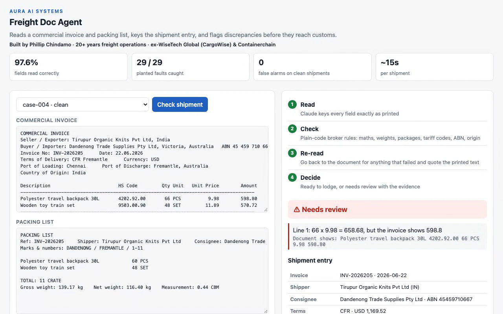

# Freight Doc Agent

Reads a supplier's **commercial invoice** and **packing list**, keys the shipment entry, and flags discrepancies **before** they turn into customs holds, amended entries or demurrage.

Built by Phillip Chindamo: 20 years in freight forwarding and logistics (DHL Global Forwarding, Stolt-Nielsen), then six years implementing and growing logistics SaaS at WiseTech Global (CargoWise) and Containerchain. I built it with Claude.



A 39-second screen recording is in [`demo/video/freight-doc-agent-demo.mp4`](demo/video/freight-doc-agent-demo.mp4).

## The problem

Every import starts with someone retyping supplier paperwork. The invoice says 48 cartons and the packing list says 47. A line total doesn't equal quantity × price. A tariff code has only six digits. Nobody notices until the entry is queried, and by then the container is sitting at the wharf. I did this work by hand for years, and the errors are almost always in the documents, not in the typing.

## What it does

```
invoice + packing list
        │
        ▼
 1. Extract ── Claude keys every field exactly as printed (no "fixing" the supplier's maths)
        │
        ▼
 2. Check ──── plain-code rules a broker runs: line maths, invoice total, invoice vs packing list
        │      weights and package counts, gross ≥ net, 8-digit AU tariff codes, ABN checksum,
        │      country of origin, Incoterms 2020, currency
        ▼
 3. Re-read ── for every failed check, go back to the document for those fields only and
        │      quote the printed text: was it a misread, or is the document really wrong?
        ▼
 4. Decide ─── READY to lodge, or NEEDS REVIEW with each flag and the printed evidence
```

**The design decision that matters is step 3.** A forwarder who keys the wrong number creates a customs problem. One who quietly "corrects" a supplier's wrong number hides one. So the agent never edits the document's numbers to make them agree. It re-reads them, and if the printed text confirms a discrepancy, a person sees it with the quote attached.

The rules are plain code, not a model, so every flag can be explained and repeated. The model does the reading, which is the hard part for code.

## Results

First full run, 18 Nov 2026, 50 shipments, Claude Sonnet through Claude Code:

| Measure | Result |
|---|---|
| Fields keyed exactly as printed | 97.6% |
| Entries with every field right | 39 of 50 |
| Planted faults caught (recall) | 100% |
| Flags that were real faults (precision) | 100% |
| Clean shipments passed with no false alarm | 21 of 21 |

The re-read step corrected no misreads on this test set, because the first read was already accurate. Its job here was confirming real faults and attaching the printed evidence. The run without it was cut short by a usage limit (20 of 50 failed), so the comparison still needs to be re-run.

The test set is 50 synthetic shipments (`eval/generate.js`). They cover eight supplier countries, three invoice layouts, European number formats ("1.234,50"), mixed date formats, and yen invoices with no decimals. 29 of them have known faults planted. The expected answer is what the documents *print*, so the agent is scored on reading accurately and on catching the planted faults, not on guessing what the supplier meant. Every company, ABN and number is invented.

## Run it

```bash
npm install
npm test                                   # rule tests, no model calls
node eval/generate.js                      # build the 50-case test set
node src/cli.js eval/cases/case-002/commercial_invoice.txt eval/cases/case-002/packing_list.txt
node eval/run.js                           # score the agent (add --no-reread to see the difference step 3 makes)
npm run demo                               # demo page at http://localhost:4321
npm run record                             # re-record the demo video (needs the demo running)
```

It uses the Claude API (`claude-opus-5-5`, structured outputs) when `ANTHROPIC_API_KEY` is set. Without a key it runs through Claude Code (`claude -p`) and validates the JSON against the same schema.

## What I'd build next

- PDF and scanned-image input (the API path already accepts document blocks; the eval needs real-looking scans).
- Tariff code lookups against the Working Tariff, and FTA preference checks from the origin country.
- Output straight into a CargoWise-style shipment record, and a review screen where a person accepts or overrides each flag.
- Real documents from a forwarder (de-identified) to measure against, since synthetic data only goes so far.

## Layout

| Path | What it is |
|---|---|
| `src/agent.js` | The extract → check → re-read → decide loop |
| `src/checks.js` | Broker rules (ABN checksum, tariff format, maths, weights) |
| `src/schema.js` | The shipment entry shape (zod) |
| `src/llm.js` | Claude API with structured outputs, or Claude Code fallback |
| `eval/` | Test-set generator, scorer and saved results |
| `demo/` | Local demo page, server-streamed steps, and the video recorder |
| `src/server.js` | Demo server: streams each agent step to the page |

## Work with me

I help Australian freight forwarders, customs brokers and 3PLs put AI to work on the manual jobs that slow them down, through [Aura AI Systems](https://auraaisystems.com.au). If your team still keys documents by hand, book a 15-minute discovery call: **[cal.com/aura-ai](https://cal.com/aura-ai)**.
